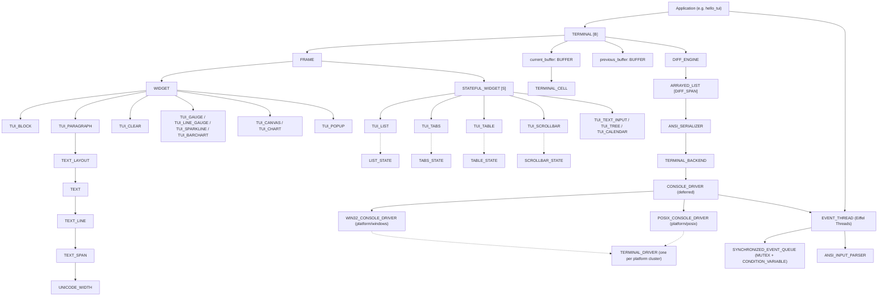

# EiffelTUI: Native Eiffel Terminal User Interface Library

EiffelTUI is a native Terminal User Interface (TUI) library and runtime for Eiffel, inspired by the architecture of Rust's [Ratatui](https://github.com/ratatui/ratatui).

It is written in pure Eiffel with inlined C console API integration, uses Design by Contract (DbC), is compiled with full void-safety, and uses Eiffel Threads (not SCOOP) for asynchronous input processing.

> **Status:** This document describes the architecture and each class's *role*. For the audited implementation state of each class (done / partial / unwired / missing), known defects, and the roadmap, see [RATATUI_MAPPING.md](RATATUI_MAPPING.md). Items marked ⚠️ below have significant limitations documented there.

---

## Architecture Overview

**Architecture Status (Milestone G):**
* `LAYOUT` is an immutable value object (direction, constraints, margin, spacing or overlap, flex justification) exposing `split (RECT): ARRAY [RECT]` and `split_with_spacers`. Every split returns fresh arrays; solutions are cached per thread by `LAYOUT_CACHE` (500 entries, LRU) keyed by `(area, layout)`. `TUI_TABLE` (columns) and the demo use it.
* Overlapping spacing (`with_overlap`, Ratatui `Spacing::Overlap`) lets neighbouring blocks share a border; `TUI_BLOCK.with_border_merged` merges the shared edges into junctions of the same line family.
* `LAYOUT_SOLVER` follows a documented deterministic algorithm: rounded percentage/ratio shares, a fixed shrink order (`Max` → `Percentage`/`Ratio` → `Fixed` → `Min`), `Flex` by weight, `Min` growth, `Legacy`, and symmetric justification. Postconditions check that chunks lie inside the area, span it across the split, exactly fill it whenever the layout can absorb all space, and are ordered and non-overlapping (with an overlap: never step back, and neighbours share at most the overlap).
* `FLEX_JUSTIFY` is a value type: `Start`, `End`, `Center`, `SpaceBetween`, `SpaceAround`, `SpaceEvenly`, and `Legacy`.
* Widget layer (Milestone F): every widget, with and without a block, renders into zero-size, tiny and off-buffer areas without raising (`TEST_WIDGET_SMOKE`). Features by widget:
  * `TUI_TABLE`: horizontal column scrolling (`TABLE_STATE.column_offset`) over columns kept at their requested width, following the selected column; row/column/cell highlights applied after the cells (Ratatui order).
  * `TUI_BARCHART`: bar groups with labels and `group_gap` in both orientations (`BAR_GROUP`, `BAR_CHART_DIRECTION`), label clipping and hidden oversized values.
  * `TUI_CHART`: bordered legend with positioning and Ratatui's hiding rule (`CHART_LEGEND_POSITION`), dataset markers for every graph type (`CANVAS_MARKER`), bar graph type rising from 0 (`CHART_GRAPH_TYPE`), axis titles (the y title on its own row), y labels drawn bottom-up from the minimum, label alignments, all text clipped to the chart area.
  * `TUI_CANVAS`: stacked `CANVAS_LAYER`s with their own marker, per-marker resolution (Braille 2×4, HalfBlock 1×2, Dot/Block 1×1), `SHAPE` hierarchy (`SHAPE_LINE`, `SHAPE_RECT`, `SHAPE_CIRCLE`, `SHAPE_POINTS`), per-dot color policy, text clipped to the canvas.
  * `TUI_BLOCK`: multiple titles (`BLOCK_TITLE`) plus the `with_title` title, laid out per side and alignment, four-sided interior `PADDING`, custom `BORDER_SET`, background style patched over the area (clipped), borders in the block style patched by the border style.
  * `TUI_LIST`: multi-line items with row-based scrolling, full-row highlight filling, direction (`LIST_DIRECTION`), repeat highlight symbol, scroll padding without blank rows at the end, highlight spacing with Ratatui semantics.
  * `TUI_TABS`: left and right padding (tab style; only the title is highlighted), divider and tab title clipping to area.
  * `TUI_GAUGE` & `TUI_LINE_GAUGE`: fg/bg color inversion over filled cells with an explicit label colour kept, label clipping (wide characters included); the line gauge clips its label (no ellipsis) and floors the filled share.
  * `TUI_SPARKLINE`: default left-to-right ordering and `SPARKLINE_DIRECTION` support.
* `TUI_APPLICATION` is unified directly on `TERMINAL [B]` and `FRAME` (`render (FRAME)`), with a single rendering pipeline. Any exception restores the terminal first and is then re-raised.
* `CONSOLE_DRIVER` has one implementation per OS under `library/platform/<os>/`. The ECF compiles exactly one platform cluster (`<condition><platform .../>`), and that cluster's `TERMINAL_DRIVER` is the default driver. Windows headers are never seen by a POSIX build, and vice versa.
* `ANSI_TERMINAL_BACKEND` and `EVENT_THREAD` talk to the driver only through `CONSOLE_DRIVER`. The backend can write to a capture string instead of stdout, so tests can check the exact bytes it emits.
* Rendering core: display widths generated from the Unicode 16.0 database, one grapheme cluster per cell (combining marks, emoji ZWJ sequences, flags, skin tones), buffers that stay continuation-consistent under every write, per-grapheme clipping at both edges, saturating `RECT` bounds, in-place cell updates with swapped front/back buffers, synchronized frame output (mode 2026), and SGR deltas.
* Ergonomics (Milestone G): `with_*` builders return copies, `STYLE` is immutable for clients, stateful widgets are generic in their state type, container widgets share `BLOCK_CONTAINER`, and the ecosystem widgets `TUI_TEXT_INPUT`, `TUI_POPUP`, `TUI_TREE` and `TUI_CALENDAR` are part of the crash-free widget layer (Section 9).
* Key events carry a kind (press, repeat, release). The Kitty keyboard protocol is opt-in (`TUI_APPLICATION.set_keyboard_enhancement`), and the Windows driver turns key-up records into the same release sequences (Section 4).
* Verified on Windows (workbench and finalized, 229/229 tests) and on Linux (Debian 12 in `docker/`, 226/226); macOS is untested (see [RATATUI_MAPPING.md](RATATUI_MAPPING.md)).

---

## Layer-by-Layer Organization

### 1. Terminal Foundation (`library/core/terminal/` & `library/platform/`)
* **[TERMINAL_BACKEND](library/core/terminal/terminal_backend.e)**: Deferred contract defining a 0-based coordinate system, viewport dimensions, screen and line clearing, `scroll_up`, cursor control, the DSR cursor query (`query_cursor_position`), mouse capture, bracketed paste, focus reporting, and keyboard enhancement (`enable_keyboard_enhancement` / `disable_keyboard_enhancement`).
* **[CONSOLE_DRIVER](library/core/terminal/console_driver.e)**: Deferred OS console driver contract. `read_char_with_timeout` delivers UTF-8 bytes on every platform and returns -1 only when the timeout expires. `is_keyboard_enhancement_enabled` tells the driver whether to report key releases (used by the Windows driver); `restore_modes` clears it.
* **Platform clusters**: `library/platform/windows/` and `library/platform/posix/` each define `TERMINAL_DRIVER` and `MONOTONIC_CLOCK`. The ECF selects one cluster by platform condition.
* **[WIN32_CONSOLE_DRIVER](library/platform/windows/win32_console_driver.e)**: Win32 console driver written as `external "C inline use <windows.h>"`, following the `eiffel-c-wrapping` skill.
  * Enables `ENABLE_VIRTUAL_TERMINAL_PROCESSING` / `ENABLE_VIRTUAL_TERMINAL_INPUT` and UTF-8 code pages. When std handles are redirected it falls back to `CONIN$`/`CONOUT$`, opened once and cached.
  * Saves the original input/output modes and code pages before the first change, and `restore_modes` puts them back exactly. `disable_raw_mode` and `disable_mouse` restore only the bits they changed.
  * `ReadConsoleInputW` reads UTF-16 key records and re-encodes them as UTF-8 bytes, handling surrogate pairs and repeat counts. Non-character records are skipped without ending the wait. The read is declared `C blocking`, so it never holds up the Eiffel GC.
  * With keyboard enhancement, key-up records become Kitty release sequences (`CSI code;mods:3u` for characters, Enter, Tab, Backspace, Esc, and Ctrl+letter/digit through the virtual key; `CSI 1;mods:3A..H` for arrows, Home and End; `CSI n;mods:3~` for Insert, Delete, PageUp/Down and F1..F12), which the shared parser decodes. Auto-repeat arrives as further key-down records, i.e. as presses.
  * Disables quick-edit mode while mouse capture is active.
  * Registers a console Ctrl handler (`SetConsoleCtrlHandler`) that writes the reset sequence and restores the saved modes. Handles and saved modes live in file-scope C globals, defined once, so the handler (which runs on a system thread) can reach them. Test hooks (`eiffeltui_w32_ctrl_handler_registered`, `eiffeltui_w32_invoke_ctrl_handler`) let the test suite check the registration and run the handler without delivering a real Ctrl event.
* **[POSIX_CONSOLE_DRIVER](library/platform/posix/posix_console_driver.e)**: POSIX driver built on `termios` raw mode (the `cfmakeraw` flags), `ioctl(TIOCGWINSZ)` sizing, and `poll` reads declared `C blocking`. It saves the complete original `termios` once and restores it exactly. SIGINT/SIGTERM/SIGHUP/SIGQUIT handlers restore the tty and re-raise the signal. Verified on Linux in Docker; macOS untested.
* **[VIRTUAL_TERMINAL](library/core/terminal/virtual_terminal.e)**: Headless, in-memory terminal backend for deterministic unit testing. It simulates resize (`set_size`), scrolling with scrollback, and cursor reports. It decodes UTF-8 output, skips escape sequences, follows CSI cursor positions, and advances the cursor by display width.
* **[ANSI_TEXT_SCANNER](library/core/terminal/ansi_text_scanner.e)**: Incremental scanner shared by both backends. It separates printable text from CSI, OSC and two-character escape sequences (state persists across writes) and reports cursor positioning (`CSI row;col H`, omitted parameters default to 1).
* **[ANSI_TERMINAL_BACKEND](library/core/terminal/ansi_terminal_backend.e)**: Production VT100/ANSI escape backend.
  * Supports mouse capture (`?1000h/?1002h/?1006h`), bracketed paste (`?2004h`), focus reporting (`?1004h`), and the DSR cursor query.
  * Tracks the cursor the way the terminal moves it: UTF-8 output is decoded and measured by display width, escape and OSC sequences are skipped, and CSI cursor positions are followed (via `ANSI_TEXT_SCANNER`).
  * `leave_raw_mode` writes and flushes every reset before the driver restores the console modes.
  * Keyboard enhancement pushes the Kitty flags 1+2 (`CSI >3u`: disambiguate escape codes, report event types) and pops them (`CSI <u`); `leave_raw_mode` pops them if still pushed. The Ctrl/signal handlers' reset sequences pop them too.
  * Output can go to a capture string (`make_with_driver_and_sink`) for tests.
* **[VIEWPORT](library/core/terminal/viewport.e)**: Fullscreen, fixed and inline viewport descriptions. Viewport origin coordinates (`origin_row`, `origin_column`) are applied by the diff serializer and by hardware cursor placement. Inline behaviour (placement, `insert_before`, restore) is implemented by `TERMINAL`.

### 2. Buffer, Cell & Diff Engine (`library/core/buffer/` & `library/core/style/`)
* **[COLOR](library/core/style/color.e)**: Default, 16-color ANSI, 256-color palette index, 24-bit TrueColor RGB, and an explicit reset (`Reset_color`, Ratatui `Color::Reset`) that clears a color when used in a patch. Supports ANSI SGR underline color (`sgr_ul`). Named constants follow Ratatui (`Gray` = ANSI 7, `Dark_gray` = ANSI 8), and `rgb (r, g, b)` builds a TrueColor value.
* **[STYLE_FLAGS](library/core/style/style_flags.e)**: Bitmask for bold, dim, italic, underline, blink, reverse, hidden, and strikethrough, with queries (`is_bold`, ..., `has_flag`) and the value operations `make_with_bits`, `plus alias "+"` and `minus alias "-"`. Its setters (`set_*`, `add_flag`, `remove_flag`, `set_bits`) are exported to `STYLE` only, so a style's flag sets cannot be changed through `{STYLE}.flags`.
* **[STYLE](library/core/style/style.e)**: Immutable value combining foreground, background, underline color, and modifier flags. `is_equal` compares every attribute; `same_rendering` compares only what is displayed (used by the diff and the serializer). Patch modifiers (`add_modifier`, `sub_modifier`), fluent builders that return copies (`with_*`, `with_fg`, `with_bg`, `without_modifier`), queries (`is_bold`, `is_italic`, ...), and `patch` with subtractive modifiers and color reset. The `set_*` commands are exported to `{STYLE}` only (used on fresh copies inside the builders), so one style object can be shared by any number of cells and widgets.
* **[UNICODE_WIDTH](library/core/buffer/unicode_width.e)**: Display widths (0 / 1 / 2 columns) and grapheme cluster segmentation. The class is generated by `tools/generate_unicode_width.py` from the Unicode 16.0.0 `EastAsianWidth.txt`, `DerivedGeneralCategory.txt` and `emoji-data.txt`, with binary search over range tables. `grapheme_end` implements the UAX #29 subset that matters for cells (CR LF, combining/format/variation-selector extension, emoji modifiers, emoji ZWJ sequences, regional-indicator pairs). `grapheme_width` handles VS15/VS16, ZWJ and flags. `string_width` measures cluster by cluster, so it agrees with `BUFFER` placement, and saturates at 65535.
* **[TERMINAL_CELL](library/core/buffer/terminal_cell.e)**: Grid cell holding one grapheme cluster (exported read-only as `READABLE_STRING_32`), style, width and continuation status. Single code points come from a shared symbol pool, so writing ASCII allocates nothing. `BUFFER` updates cells in place; styles are immutable, so cells share style references (`set_style` stores the reference, no copy). `same_content` compares what is displayed.
* **[BUFFER](library/core/buffer/buffer.e)**: Flat `SPECIAL [TERMINAL_CELL]` 2D grid, one grapheme cluster per cell, with wide-character continuation cells. Every writing operation keeps rows continuation-consistent (postconditions): wide-over-wide repair, right-edge blanking with the caller's style, `put_char` ignoring zero-width characters, and `resize` / `merge` repairing cut wide characters. `set_string_clipped` / `set_line_clipped` lay text out from any column (even negative, e.g. when scrolled horizontally) and clip per grapheme at both edges; a zero-width cluster starting a span attaches to the previous cell. API: `area: RECT`, `resize`, `set_stringn`, `set_span`, `set_line`, `set_style (RECT, STYLE)`, `merge`, `is_consistent`.
* **[DIFF_SPAN](library/core/buffer/diff_span.e)**: Contiguous dirty cell run on a single line with `reset` for reuse.
* **[DIFF_ENGINE](library/core/buffer/diff_engine.e)**: Framebuffer delta comparator that compares cells by displayed content, merges dirty runs separated by gaps of ≤ 4 cells, and reuses `DIFF_SPAN` objects from a pool (a result is valid until the next `diff` call).
* **[ANSI_SERIALIZER](library/core/buffer/ansi_serializer.e)**: Emits diff spans as cursor moves and SGR deltas (only added attributes; nothing between visually equal styles; a full reset sequence when an attribute is removed), wrapped in synchronized output mode 2026 (`\e[?2026h` / `\e[?2026l`), with an explicit SGR reset (`\e[0m`) at frame start. Accumulates the entire frame into a single `STRING_8` (UTF-8) for single-write flushing.

### 3. Layout Solver (`library/core/layout/`)
* **[RECT](library/core/layout/rect.e)**: Pure geometric 0-based boundary box (`x`, `y`, `width`, `height: NATURAL_16`) with invariant `x + width <= 65535 and y + height <= 65535`, saturating arithmetic in `make` and `inner`, intersection, union, and geometry helpers (`offset`, `clamp` (moves the rect inside the bounds, like Ratatui), `centered`, `rows`, `columns`, `positions`).
* **[MARGIN](library/core/layout/margin.e)** & **[SPLIT_DIRECTION](library/core/layout/split_direction.e)**: Layout orientation and margin models.
* **[SPACING](library/core/layout/spacing.e)**: `Space (n)` or `Overlap (n)` between neighbouring chunks (Ratatui `Spacing`); `effective_spacing` is the signed value `LAYOUT` stores.
* **[CONSTRAINT](library/core/layout/constraint.e)** & **[CONSTRAINTS](library/core/layout/constraints.e)**: Hierarchy supporting `Fixed` (Ratatui `Length`), `Percentage`, `Ratio`, `Min`, `Max`, and `Flex` (Ratatui `Fill`).
* **[FLEX_JUSTIFY](library/core/layout/flex_justify.e)**: Value type for the placement of spare space: `Start`, `End`, `Center`, `SpaceBetween`, `SpaceAround` (edges get half the space between chunks), `SpaceEvenly`, and `Legacy` (the last chunk absorbs it).
* **[LAYOUT](library/core/layout/layout.e)**: Immutable value object combining direction, constraints, margin, spacing, and flex justification; change it with the `with_*` builders. `constraints` returns a copy; `constraint_count` / `constraint (i)` read it. `with_spacing` / `with_overlap` / `with_spacing_model` set the gap or overlap. `split (RECT): ARRAY [RECT]`, `split_list` and `split_with_spacers` (chunks plus the n + 1 spacers around them) return fresh results (copies of the cached solution), with postconditions `is_well_formed` and `covers_length`.
* **[LAYOUT_SOLVER](library/core/layout/layout_solver.e)**: Deterministic splitter (not a Cassowary solver like Ratatui's):
  1. `(n - 1) * spacing` cells are reserved for gaps; the rest is available. An overlap (negative spacing) adds `(n - 1) * overlap` cells instead, because neighbours share them.
  2. Base sizes: `Fixed` = value, `Min` = minimum, `Max` = maximum, `Percentage`/`Ratio` = floor of the exact share (computed in 64 bits), `Flex` = 0.
  3. Rounding: the cells lost to flooring are given back by largest remainder, but only `round (Σ exact shares) − Σ floors` of them (33% of 10 is 3; three `Ratio(1,3)` of 100 are 34 + 33 + 33).
  4. Too little space: shrink `Max` first, then `Percentage`/`Ratio`, then `Fixed`, and `Min` last, each group proportionally. `Min` keeps its minimum whenever the others can give way.
  5. Spare space: `Flex` shares it by weight; without `Flex`, `Min` grows in proportion to its minimum; otherwise `Legacy` gives it to the last chunk.
  6. The rest is placed by the flex justification. Offsets are rounded from exact positions, so `SpaceBetween` / `SpaceAround` / `SpaceEvenly` are symmetric and drop no cells.
  * All length and position arithmetic is 32/64-bit and clamped to the area (huge spacing leaves empty chunks at the end, never outside).
  * With an overlap, a chunk never starts before the previous one (a zero-width chunk does not make its successor step back).
  * Postconditions: `is_well_formed` (ordered, non-overlapping, positioned inside the area, spanning the cross axis) or, with an overlap, `is_well_formed_with_overlap` (monotonic starts, neighbours share at most the overlap), and `is_filling implies fills_length`.
* **[LAYOUT_CACHE](library/core/layout/layout_cache.e)** & **[LAYOUT_CACHE_KEY](library/core/layout/layout_cache_key.e)**: Bounded cache (default 500 entries) of layout solutions and spacers keyed by `(area, layout)`; the key hashes the constraint values. A hit hashes once with a reused lookup key and allocates nothing; `LAYOUT.split` / `split_list` then copy only the chunks (never the spacers). Least-recently-used eviction through a doubly linked list of **[LAYOUT_CACHE_ENTRY](library/core/layout/layout_cache_entry.e)** nodes. `LAYOUT` keeps one cache per thread; it is not synchronized.

### 4. Events, Raw Mode & Threaded Input (`library/core/event/`)
* **[MODIFIERS](library/core/event/modifiers.e)**: Shift, Control, Alt, Super bitmask flags.
* **[KEY_CODE](library/core/event/key_code.e)**: Character keys, arrows, navigation (Home, End, PageUp, PageDown), editing (Backspace, Delete, Insert), and F1..F35.
* **[EVENT](library/core/event/event.e)** hierarchy: `KEY_EVENT`, `MOUSE_EVENT`, `RESIZE_EVENT`, `TICK_EVENT`, `PASTE_EVENT`, `FOCUS_EVENT`, `CURSOR_POSITION_EVENT`.
* **[KEY_EVENT](library/core/event/key_event.e)**: Key code, modifiers and `kind` (`Kind_press`, `Kind_repeat`, `Kind_release`; `is_press`, `is_repeat`, `is_release`). Legacy terminal input produces presses only; repeats and releases need keyboard enhancement.
* **[ANSI_INPUT_PARSER](library/core/event/ansi_input_parser.e)**: State-machine parser. It handles:
  * a streaming UTF-8 decoder (2-, 3- and 4-byte sequences) that restarts on broken sequences
  * lone ESC timeout flush (`flush_escape`), with ESC+char decoded as Alt+char
  * a bounded parameter buffer (max 64 bytes)
  * the full xterm modifier bitmask (Shift/Alt/Ctrl/Super) on CSI keys, and modified F1–F4 (`\e[1;5P` and the tilde forms `\e[11~`..`\e[14~`; Kitty sends F3 only as `\e[13~`)
  * the Kitty keyboard protocol: an `:event-type` after the modifiers of any CSI key (1 press, 2 repeat, 3 release), and `CSI key[:alternates] ; mods[:event] u` keys per the specification (Esc, Enter, Tab, Backspace, F13..F35, the keypad, printable code points; alternate keys ignored; lock, media and modifier keys produce no event)
  * SGR 1006 mouse, with modifier bits and horizontal scrolling (buttons 66/67)
  * focus reporting (`\e[I` / `\e[O`)
  * bracketed paste (`\e[200~...\e[201~`), where escape sequences inside the paste are kept as text. An input timeout inside a paste flushes nothing (a cut end marker completes with the next bytes), an ESC in the pasted text never hides the end marker, and `notify_idle` ends a paste whose end marker never arrives after `paste_timeout_ms` (default 2 s, `EVENT_THREAD.set_paste_timeout`), delivering the text collected so far
  * cursor position reports (`\e[r;cR`; with an event type, `\e[1;2:1R` is Shift+F3)
* **[SYNCHRONIZED_EVENT_QUEUE](library/core/event/synchronized_event_queue.e)**: Thread-safe FIFO queue built on `MUTEX` + `CONDITION_VARIABLE`. `poll_with_timeout` blocks without using CPU and wakes as soon as an event is pushed, on every platform.
* **[EVENT_THREAD](library/core/event/event_thread.e)**: Background `THREAD` that polls the driver, checks the console window size (`RESIZE_EVENT`), flushes a lone ESC on timeout, and pushes parsed events to the queue. A failing iteration is retried. After 10 consecutive failures the thread stops and reports it (`has_failed`, `failure_description`), and `TUI_APPLICATION` turns that into an exception.

### 5. Application Runner (`library/core/application/`)
* **[TUI_APPLICATION](library/core/application/tui_application.e)**: Unified application runner built directly on `TERMINAL [B]` and `FRAME` (`render (FRAME)`).
  * Supports fullscreen (`make`) and fixed/inline viewports (`make_with_viewport`).
  * The loop waits on `poll_with_timeout` until the next tick deadline and processes every pending event. It emits a `TICK_EVENT` every `tick_rate_ms`, even under a steady stream of input, then redraws; the diff keeps unchanged frames cheap.
  * Restoration always runs: reporting modes, cursor and screen are reset, output is flushed, the console modes are restored, and the input thread is joined. An exception from `process`, `render` or a failed input thread is re-raised *after* restoration.
  * `set_keyboard_enhancement (True)` (before `run`) pushes the Kitty keyboard flags after entering the alternate screen and pops them before leaving it (Kitty keeps one flag stack per screen), like crossterm's `PushKeyboardEnhancementFlags`.
  * The driver's Ctrl/signal handler covers termination outside Eiffel control.

### 6. Text Pipeline & Immediate-Mode Widgets (`library/core/text/` & `library/widgets/`)
* **[TEXT_SPAN](library/core/text/text_span.e)**, **[TEXT_LINE](library/core/text/text_line.e)**, **[TEXT](library/core/text/text.e)**: Multi-line rich styled text model over `STRING_32`. All three are widgets (`render` clips to the area) and convert from string types (`make_raw`); `TEXT_LINE.width` saturates at 65535.
* **[TEXT_LAYOUT](library/core/text/text_layout.e)**: Word wrapping, character wrapping, leading/trailing whitespace trimming, and alignment (`Left`, `Center`, `Right`). Words break on space and tab only.
* **[WIDGET](library/widgets/widget.e)**: Base deferred interface with `render (a_area: RECT; a_buffer: BUFFER)`.
* **[BORDERS](library/widgets/borders.e)** & **[BORDER_TYPE](library/widgets/border_type.e)**: Box-drawing corner and border glyphs (`Plain`, `Rounded`, `Double`, `Thick`).
* **[BORDER_COLLISION_SOLVER](library/widgets/border_collision_solver.e)**: Fuses adjacent border lines into junction glyphs (`┬`, `├`, `┼`, …), mirroring Ratatui's `symbols::merge`. Junctions keep the line family of the borders they join (single/rounded, thick, double; mixed families give single-line junctions), rounded corners that need no junction are kept, and only box-drawing characters are merged (text such as `-`, `|`, `+` is replaced, not fused).
* **[TUI_CLEAR](library/widgets/tui_clear.e)**: Region clearer for floating overlays and popups.
* **[TUI_BLOCK](library/widgets/tui_block.e)**, **[BLOCK_TITLE](library/widgets/block_title.e)**, **[PADDING](library/widgets/padding.e)** & **[BORDER_SET](library/widgets/border_set.e)**: Frame container with borders, multiple titles (`BLOCK_TITLE`, top/bottom with alignment; titles sharing a side and alignment are laid out one after another, and the `with_title` title is kept alongside them), four-sided interior padding (`PADDING`), custom border glyph sets (`BORDER_SET`), background style patched over the area (clipped to the buffer), borders in the block style patched by the border style, and inner area deflation. `with_border_merged (True)` (or a one-off `render_merged`) merges its borders with the borders already in the buffer, e.g. a neighbour sharing an edge through `LAYOUT.with_overlap`.
* **[TUI_PARAGRAPH](library/widgets/tui_paragraph.e)**: Multi-line text widget with wrapping, alignment, vertical and horizontal scroll (clipped per grapheme), and container block integration.

### 7. Stateful Widgets & Terminal Engine (`library/core/terminal/` & `library/widgets/`)
* **[FRAME](library/core/terminal/frame.e)**: Draw target passed to render passes (`render_widget`, `render_stateful_widget`, cursor positioning).
* **[TERMINAL [B]](library/core/terminal/terminal.e)**: Coordinates double-buffering, delta diffs, and screen flushing through agent-based draw calls `terminal.draw (agent (f: FRAME) ...)`. After each frame the two buffers are swapped (no cell copying); the new back buffer is cleared in place by the next `draw`.
  * `draw` begins with `autoresize`. Fullscreen and inline buffers follow the backend size, and a fixed viewport keeps its area (use `resize (RECT)` to change it).
  * On a size change the buffers are rebuilt and the stale content is erased: the whole screen for fullscreen/fixed viewports, only the viewport rows for inline ones.
  * Inline viewports: `setup_inline_viewport` places the viewport at the cursor row (DSR query) and scrolls up when it doesn't fit. `insert_before (n, agent)` writes rows above the viewport; they scroll into the scrollback once the viewport reaches the bottom. `restore_inline_viewport` leaves the cursor below the viewport.
* **[WIDGET_STATE](library/widgets/widget_state.e)**, **[STATEFUL_WIDGET [S]](library/widgets/stateful_widget.e)** & **[STATEFUL_WIDGET_BASE](library/widgets/stateful_widget_base.e)**: Abstraction for state-dependent widgets. `render_stateful (area, buffer, S)` is typed by the widget's state class, so calling it directly with the wrong state is a compile-time error. `FRAME.render_stateful_widget` dispatches through the non-generic `STATEFUL_WIDGET_BASE`; there a wrong state type violates the `accepts_state` precondition instead of rendering nothing.
* **[LIST_ITEM](library/widgets/list/list_item.e)**, **[LIST_STATE](library/widgets/list/list_state.e)**, **[LIST_DIRECTION](library/widgets/list/list_direction.e)** & **[HIGHLIGHT_SPACING](library/widgets/list/highlight_spacing.e)**: Selection tracking, automatic viewport scroll management measured in rows (`adjust_viewport_for_rows`; `scroll_padding` is reduced when it cannot fit and never leaves blank rows at the end), list direction (top-to-bottom, bottom-to-top), and highlight spacing (Always, When_selected, Never).
* **[TUI_LIST](library/widgets/list/tui_list.e)**: Scrollable list widget supporting multi-line items (the viewport is measured in rows, `LIST_STATE.adjust_viewport_for_rows`), full-row highlight filling (patched and clipped), `highlight_symbol` clipped to its column, `repeat_highlight_symbol`, and `HIGHLIGHT_SPACING` (Never draws no symbol).
* **[TABS_STATE](library/widgets/tabs/tabs_state.e)** & **[TUI_TABS](library/widgets/tabs/tui_tabs.e)**: Horizontal tab bar with left and right padding (`set_padding` / `with_padding`, drawn in the tab style), divider and tab title clipping to area, and active tab highlight (title only).
* **[TABLE_CELL](library/widgets/table/table_cell.e)**, **[TABLE_ROW](library/widgets/table/table_row.e)**, **[TABLE_STATE](library/widgets/table/table_state.e)** & **[TUI_TABLE](library/widgets/table/tui_table.e)**: Multi-column table with constraint-based column widths, multi-line rows, header/footer, column spacing, and row selection. Columns keep their requested widths and only those that fit after `TABLE_STATE.column_offset` are shown; the offset follows the selected column. `row_highlight_style`, `column_highlight_style` and `cell_highlight_style` are applied after the cells (full row, body column, intersection), so they win over cell styles.
* **[SCROLLBAR_ORIENTATION](library/widgets/scrollbar/scrollbar_orientation.e)**, **[SCROLLBAR_STATE](library/widgets/scrollbar/scrollbar_state.e)** & **[TUI_SCROLLBAR](library/widgets/scrollbar/tui_scrollbar.e)**: Vertical/horizontal scrollbars with track, thumb and optional arrow glyphs.

### 8. Metric & Canvas Widgets (`library/widgets/metrics/` & `library/widgets/canvas/`)
* **[TUI_GAUGE](library/widgets/metrics/tui_gauge.e)** & **[TUI_LINE_GAUGE](library/widgets/metrics/tui_line_gauge.e)**: Progress bars. The block gauge uses 1/8-block sub-cell precision, inverts the gauge colours under the label over filled cells (an explicit label colour wins), and clips labels to the gauge area, wide characters included. The line gauge clips narrow labels (no ellipsis) rather than dropping them.
* **[SPARKLINE_DIRECTION](library/widgets/metrics/sparkline_direction.e)** & **[TUI_SPARKLINE](library/widgets/metrics/tui_sparkline.e)**: Compact trend line using 8-level block glyphs with default left-to-right data ordering and `SPARKLINE_DIRECTION` support (Left_to_right, Right_to_left).
* **[BAR_ITEM](library/widgets/metrics/bar_item.e)**, **[BAR_GROUP](library/widgets/metrics/bar_group.e)**, **[BAR_CHART_DIRECTION](library/widgets/metrics/bar_chart_direction.e)** & **[TUI_BARCHART](library/widgets/metrics/tui_barchart.e)**: Vertical and horizontal bar charts with bar groups, group labels and `group_gap` in both directions (the groups are the only storage), custom bar styles, label clipping and hidden oversized values; horizontal values go after the bar or over its start.
* **[BRAILLE_CANVAS](library/widgets/canvas/braille_canvas.e)**, **[CANVAS_PAINTER](library/widgets/canvas/canvas_painter.e)**, **[TUI_CANVAS](library/widgets/canvas/tui_canvas.e)**, **[CANVAS_LAYER](library/widgets/canvas/canvas_layer.e)** & **[SHAPE](library/widgets/canvas/shape.e)**: Sub-cell drawing surface (Braille 2×4 dots per cell, HalfBlock 1×2, Dot/Block/Bar 1×1) with stacked layers (`CANVAS_LAYER`, a later layer's cells replace the ones below, each layer with its own marker), per-axis circles, text clipped to the canvas, per-dot color policy (`Policy_last_wins`, `Policy_first_wins`), and a polymorphic shape hierarchy (`SHAPE_LINE`, `SHAPE_RECT`, `SHAPE_CIRCLE`, `SHAPE_POINTS`).
* **[TUI_CHART_DATASET](library/widgets/canvas/tui_chart_dataset.e)**, **[TUI_CHART](library/widgets/canvas/tui_chart.e)**, **[CANVAS_MARKER](library/widgets/canvas/canvas_marker.e)**, **[CHART_GRAPH_TYPE](library/widgets/canvas/chart_graph_type.e)** & **[CHART_LEGEND_POSITION](library/widgets/canvas/chart_legend_position.e)**: Line, scatter, and bar charts (bars from 0) with the dataset marker for every graph type (`CANVAS_MARKER`: Braille, Dot, Block, HalfBlock), a bordered legend with positioning and Ratatui's hiding rule (`set_legend_hidden_ratio`), axis titles (`x_title`; `y_title` on its own row above the plot), y labels listed from the minimum and drawn bottom-up, label alignments, and all text clipped to the chart area.

### 9. Ergonomics & Ecosystem (`library/widgets/`, `library/core/style/`, `library/widgets/input/`, `library/widgets/popup/`, `library/widgets/tree/`, `library/widgets/calendar/`)
* **[BLOCK_CONTAINER](library/widgets/block_container.e)**: Shared ancestor of every widget that can sit in a block (all except `TUI_BLOCK`, `TUI_CLEAR`, `TUI_SCROLLBAR` and the text types), providing `block: detachable TUI_BLOCK`, `set_block` / `with_block`, `inner_area` deflation, and `render_block`.
* **Generic stateful widgets**: `STATEFUL_WIDGET [S -> WIDGET_STATE]` (see Section 7), bridged to non-generic `STATEFUL_WIDGET_BASE` for dispatch in `FRAME`, with an `accepts_state` precondition on that path.
* **CQS & Style Immutability**: Widget and element configuration queries (`with_*`) return modified `twin` copies and leave `Current` unchanged; this includes the element builders on `LIST_ITEM`, `BAR_ITEM`, `BAR_GROUP`, `TUI_CHART_DATASET` and the `LIST_STATE` / `SCROLLBAR_STATE` builders. A copy owns its lists and copies of their elements (list items, table rows and cells, text lines and spans, block and tab titles, bar groups and items, canvas shapes and layers, chart datasets and their point lists, tree nodes), so changing or adding to a copy leaves the original unchanged. `TUI_LIST`, `TUI_TABLE`, `TUI_PARAGRAPH`, `TUI_TREE`, `TUI_CHART` and `TUI_CANVAS` copy their content on write: a copy shares the items, rows, text, nodes, datasets, shapes and layers until either object accesses them through its public API (`items`, `rows`, `text`, `roots`, `datasets`, `shapes`, `layers`, or a command that adds content), which gives that object its own element copies first. Rendering reads the shared content without copying, so a chain of `with_*` builders followed by `render` copies nothing (a 1000-item list: 2.8 ms per frame with deep copies, about 0.001 ms with copy-on-write, finalized build). One consequence: an element fetched from a widget before copying it may afterwards belong to the copy, so fetch elements again after a `with_*` call rather than keeping references across it. Widgets compare by content (`is_equal`, `BLOCK_CONTAINER.same_block`). `STYLE` and `STYLE_FLAGS` mutators are restricted to `{STYLE}`, enabling safe style sharing without defensive copying.
* **[SYMBOLS_BAR](library/core/style/symbols_bar.e)**, **[SYMBOLS_BLOCK](library/core/style/symbols_block.e)**, **[SYMBOLS_MARKER](library/core/style/symbols_marker.e)** & **[TUI_THEME](library/core/style/tui_theme.e)**: Named Unicode symbols and semantic palette object with `dark`, `light`, `nord`, and `dracula` presets.
* **Direct Text Rendering & Conversions**: `TEXT_SPAN`, `TEXT_LINE`, and `TEXT` inherit `WIDGET` for direct rendering and provide `convert` from string types.
* **[TUI_TEXT_INPUT](library/widgets/input/tui_text_input.e)** & **[TEXT_INPUT_STATE](library/widgets/input/text_input_state.e)**: Single-line text input. Editing and cursor movement step over whole grapheme clusters; text is laid out by display width and clipped to the area; the view scrolls by display column to keep the cursor (and the wide cluster under it) visible, and pulls back when text is deleted. Placeholder text, cursor style, password masking (one mask character per cluster), and `cursor_screen_position` for placing the terminal's hardware cursor with `FRAME.set_cursor_position`. `value` is a read-only view; edits go through the state's commands.
* **[TUI_POPUP](library/widgets/popup/tui_popup.e)**: Modal overlay container with background clearing (`TUI_CLEAR`), inner widget delegation, and centering helpers (`centered_rect`, `fixed_rect`).
* **[TUI_TREE](library/widgets/tree/tui_tree.e)**, **[TREE_NODE](library/widgets/tree/tree_node.e)** & **[TREE_STATE](library/widgets/tree/tree_state.e)**: Collapsible hierarchical tree widget with depth indentation, expanded/collapsed/leaf symbols (measured by display width), selection highlighting, `select_next` / `select_previous` / `visible_nodes` over the visible rows, a scroll offset that follows the selection, and a fallback to the deepest visible ancestor when the selected node is collapsed away (`collapse_node`; the widget records the selected node's ancestors in the state, so `TREE_STATE.collapse_node` alone works too). Expanded ids are a hash set. All writes are clipped to the area. Node ids identify expansion and selection and should be unique.
* **[TUI_CALENDAR](library/widgets/calendar/tui_calendar.e)** & **[CALENDAR_STATE](library/widgets/calendar/calendar_state.e)**: Monthly calendar widget with Sakamoto day-of-week math (floor division, valid for every proleptic Gregorian year), month/year header, weekday labels starting on a configurable `first_day_of_week`, a 7-column day grid clipped to the area, selected-day style, per-date styles (a table or an agent; impossible dates are rejected), the adjacent months' days in the first and last week (`with_show_surrounding`), and day/week/month/year navigation.

---

## Ratatui to EiffelTUI Mapping Reference

Name correspondence only; see [RATATUI_MAPPING.md](RATATUI_MAPPING.md) for implementation status.

| Ratatui (Rust) | EiffelTUI (Eiffel) | Purpose |
| :--- | :--- | :--- |
| `Backend` | `TERMINAL_BACKEND` | Abstract terminal interface |
| `CrosstermBackend` | `ANSI_TERMINAL_BACKEND` | Terminal escape code backend |
| `TestBackend` | `VIRTUAL_TERMINAL` | In-memory headless terminal |
| crossterm platform layer | `CONSOLE_DRIVER` → `TERMINAL_DRIVER` (`WIN32_CONSOLE_DRIVER` / `POSIX_CONSOLE_DRIVER`) | OS console / tty access |
| `Viewport` | `VIEWPORT` (+ inline operations on `TERMINAL`) | Fullscreen / fixed / inline drawing region |
| `Terminal::insert_before` | `TERMINAL.insert_before` | Rows printed above an inline viewport |
| `Color` | `COLOR` | ANSI / Indexed / RGB colors |
| `Modifier` | `STYLE_FLAGS` | Bold, Italic, Underline, etc. |
| `Style` | `STYLE` | Visual styling and SGR emitter |
| `unicode-width` / `unicode-segmentation` crates | `UNICODE_WIDTH` | Display width and grapheme clusters |
| `Cell` | `TERMINAL_CELL` | Buffer grid cell |
| `Buffer` | `BUFFER` | 2D framebuffer |
| `Rect` | `RECT` | Bounding rectangle |
| `Constraint` | `CONSTRAINT` / `CONSTRAINTS` | Layout constraints (`Length`→`Fixed`, `Fill`→`Flex`) |
| `Layout` | `LAYOUT`, `LAYOUT_SOLVER` | Rectangular area divider |
| `Flex` | `FLEX_JUSTIFY` | Leftover space distribution |
| `Spacing` (`Space` / `Overlap`) | `SPACING` (`LAYOUT.with_spacing` / `with_overlap`) | Gap or shared cells between chunks |
| `symbols::border` | `BORDERS`, `BORDER_TYPE` | Box-drawing glyph sets |
| `symbols::merge` | `BORDER_COLLISION_SOLVER` | Border junction merging |
| `symbols::bar` | `SYMBOLS_BAR` | Fractional vertical and horizontal bars |
| `symbols::block` | `SYMBOLS_BLOCK` | Half blocks, quadrants, shades |
| `symbols::marker` | `SYMBOLS_MARKER` | Dots, braille, diamonds, check marks |
| `Theme` / palette | `TUI_THEME` | Semantic color and style palettes |
| `Span` | `TEXT_SPAN` | Styled text slice |
| `Line` | `TEXT_LINE` | Horizontal line of spans |
| `Text` | `TEXT` | Multi-line text buffer |
| `Widget` | `WIDGET` | Immediate-mode render target |
| `StatefulWidget` | `STATEFUL_WIDGET [S]`, `STATEFUL_WIDGET_BASE` | State-dependent render target |
| (block composition) | `BLOCK_CONTAINER` | Optional surrounding block for any widget |
| `Block` | `TUI_BLOCK`, `BLOCK_TITLE`, `PADDING`, `BORDER_SET` | Borders and container frame |
| `Paragraph` | `TUI_PARAGRAPH` | Wrapped text renderer |
| `List` / `ListState` | `TUI_LIST` / `LIST_STATE`, `LIST_DIRECTION`, `HIGHLIGHT_SPACING` | Scrollable selectable list |
| `Tabs` | `TUI_TABS` / `TABS_STATE` | Horizontal tab bar |
| `Table` / `TableState` | `TUI_TABLE` / `TABLE_STATE` | Multi-column data grid |
| `Scrollbar` / `ScrollbarState` | `TUI_SCROLLBAR` / `SCROLLBAR_STATE` | Scroll position indicator |
| `Gauge` / `LineGauge` | `TUI_GAUGE` / `TUI_LINE_GAUGE` | Progress bars |
| `Sparkline` | `TUI_SPARKLINE`, `SPARKLINE_DIRECTION` | Inline trend chart |
| `BarChart` / `BarGroup` | `TUI_BARCHART`, `BAR_ITEM`, `BAR_GROUP`, `BAR_CHART_DIRECTION` | Bar chart |
| `Canvas` / `Shape` | `TUI_CANVAS`, `BRAILLE_CANVAS`, `CANVAS_PAINTER`, `CANVAS_LAYER`, `SHAPE` | Sub-cell vector drawing |
| `Chart` / `Dataset` | `TUI_CHART` / `TUI_CHART_DATASET`, `CANVAS_MARKER`, `CHART_GRAPH_TYPE`, `CHART_LEGEND_POSITION` | Line / scatter / bar charts |
| `Clear` | `TUI_CLEAR` | Blank cell fill |
| `TextInput` / `Input` | `TUI_TEXT_INPUT` / `TEXT_INPUT_STATE` | Single-line text input |
| `Popup` | `TUI_POPUP` | Centered modal overlay container |
| `Tree` / `TreeState` | `TUI_TREE` / `TREE_NODE` / `TREE_STATE` | Hierarchical collapsible tree |
| `Calendar` / `CalendarState` | `TUI_CALENDAR` / `CALENDAR_STATE` | Monthly calendar grid |
| `KeyEvent` / `KeyEventKind` | `KEY_EVENT` (`kind`, `is_press` / `is_repeat` / `is_release`) | Key event with press / repeat / release |
| `PushKeyboardEnhancementFlags` / `PopKeyboardEnhancementFlags` | `TUI_APPLICATION.set_keyboard_enhancement`, `TERMINAL_BACKEND.enable_keyboard_enhancement` / `disable_keyboard_enhancement` | Kitty keyboard protocol |
| `Frame` | `FRAME` | Active drawing context |
| `Terminal` | `TERMINAL [B]` | Dual-buffer render coordinator |
